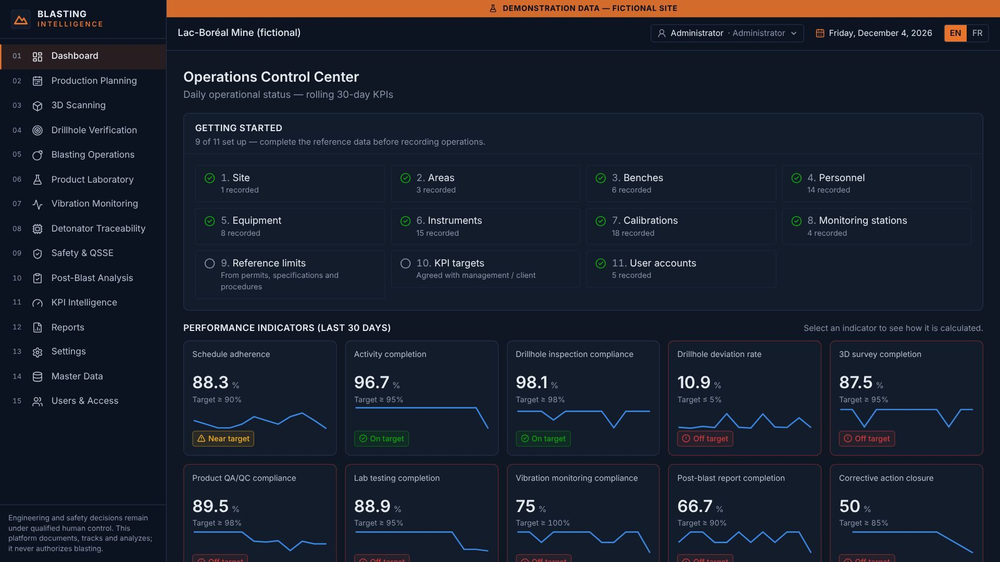
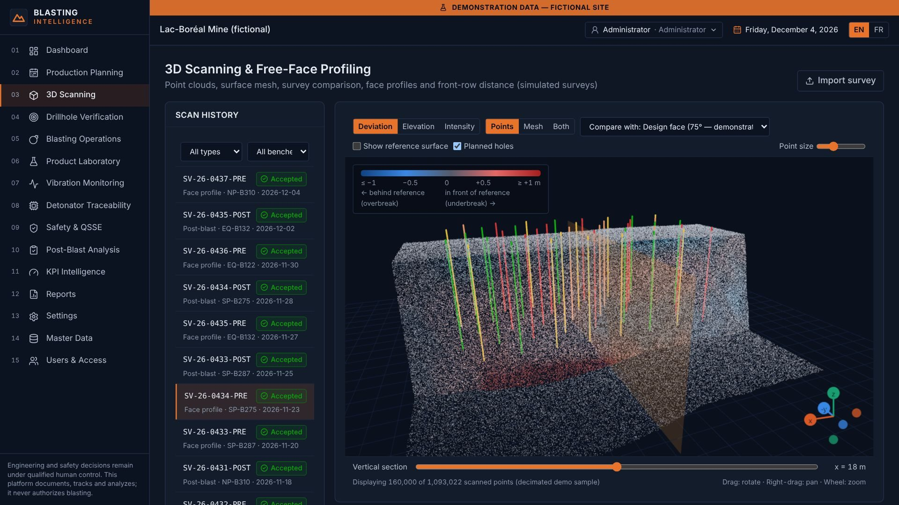
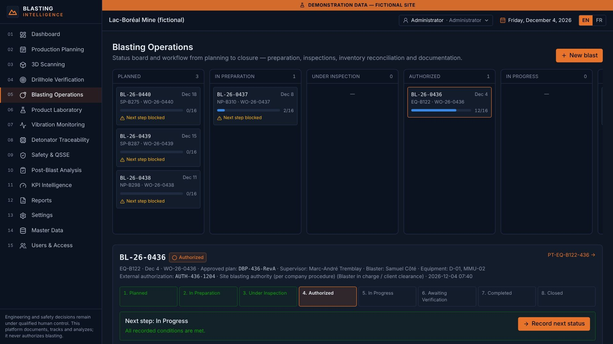
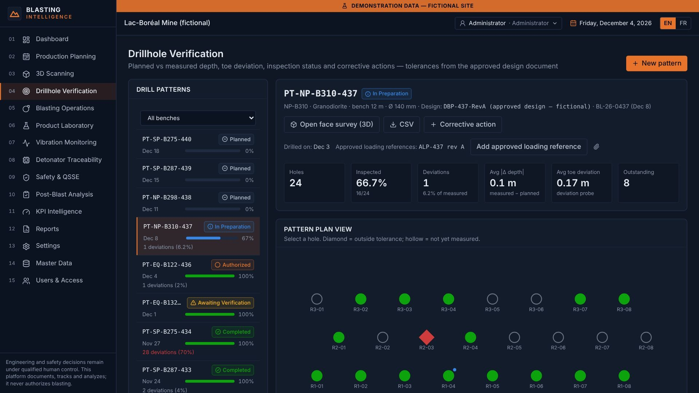
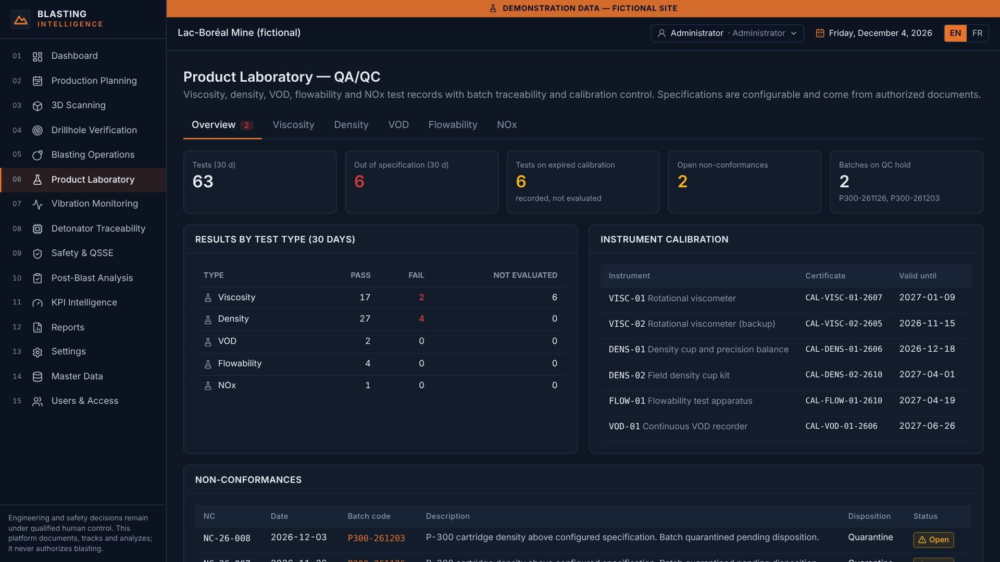
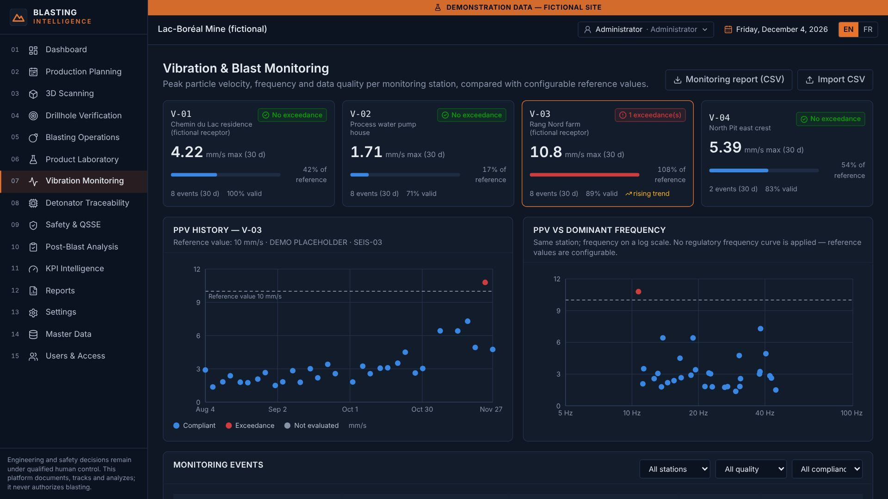

# Blasting Intelligence

[](https://github.com/SeanMedeiros/blasting-intelligence/actions/workflows/ci.yml)
[](LICENSE)


**Integrated Drilling, Blasting, 3D Scanning & Technical Performance Platform**

Documentation, monitoring, analysis and performance evaluation of drilling and blasting services:
planning, 3D face surveys, drillhole verification, blasting workflow, product QA/QC, vibration
monitoring, detonator traceability, QSSE, post-blast analysis, KPIs and automated reports.

▶ **Demo video (2 min 30 s, narrated):** see the latest [release](../../releases/latest).

| Operations Control Center | 3D free-face profiling |
|---|---|
|  |  |
| **Blasting workflow** | **Drillhole verification** |
|  |  |
| **Product laboratory** | **Vibration monitoring** |
|  |  |

<sub>Screenshots and video use the built-in demonstration dataset: a fictional mine, simulated data.</sub>

> **Two modes, two separate databases.**
> **Production** (`start.bat`): real date in the site time zone, starts empty, a *Getting started*
> checklist guides the set-up of master data, limits, targets and accounts.
> **Demonstration** (`start_demo.bat`, port 8001): fictional site with a fixed date, regenerated on demand.
>
> A new site is operated entirely from the interface: master data → work order and activity sequence →
> drill pattern with the drillhole design imported from the design software (CSV) → hole verification →
> blast (checkpoints and pre-blast checklist from the site templates) → external authorization recorded →
> firing → vibration import → post-blast review → detonator reconciliation → closure → KPIs and reports.
>
> The platform documents, tracks and analyzes. It never calculates explosive loads, issues
> loading or firing instructions, or authorizes blasting.

## Modules

| # | Module | Scope |
|---|---|---|
| 01 | Operations Control Center | Daily status, 13 KPIs with documented formulas, explainable alerts |
| 02 | Production Planning | Calendar, Gantt, forecast vs actual, deliveries, delays and schedule changes with causes |
| 03 | 3D Scanning | Point cloud / mesh viewer, design and survey-to-survey comparison, sections, front-row distance, LAS/PLY/XYZ/CSV/OBJ import-export |
| 04 | Drillhole Verification | Planned vs measured, rule-based status vs configurable tolerances, engineering acceptance record, corrective actions |
| 05 | Blasting Operations | 8-step workflow with enforced preconditions, checkpoints, pre-blast checklist, inventory reconciliation |
| 06 | Product Laboratory | Viscosity, density, VOD, flowability, NOx; calibration control, non-conformances, batch traceability |
| 07 | Vibration Monitoring | PPV / frequency trends, data-quality validation, event comparison, CSV import |
| 08 | Detonator Traceability | Administrative records, unit reconciliation, exceptions, audit trail |
| 09 | Safety & QSSE | Observations, configurable risk matrix, CAPA with closure evidence, inspections, training |
| 10 | Post-Blast Analysis | 6-stage workflow, automatic data collection, engineering review, blast comparison |
| 11 | KPI Intelligence | Targets, previous-period comparison, daily / weekly / monthly trends |
| 12 | Reports | 8 automated PDF/CSV reports, operational database browser |
| 13 | Settings | Reference limits with source document (audited), record templates, server access / HTTPS certificate, database and backups |
| 14 | Master Data | Site, areas, benches, personnel, training, equipment, instruments, calibrations, monitoring stations, product batches |
| 15 | Users & Access | Accounts, five roles, password policy, lockout, session control (administrators) |

Interface, alerts, error messages and PDF reports in English and French (Québec terminology). Personal accounts with role-based permissions; every write, sign-in and account change is recorded in the audit trail with the user's account. **Evidence files** (photos, PDF, Word, Excel, CSV, text) can be attached to blasts, checkpoints, checklists, observations, corrective actions, non-conformances, patterns, detonator records, post-blast reviews, calibrations and training — checked by content, hashed (SHA-256), never deleted (voided with a reason), included in backups.

## Install and run (Windows, single workstation)

Requirements: **Python 3.11+** (3.12 recommended). Node.js is not needed — the interface is pre-built.

1. Download the latest release (or **Code → Download ZIP**, or `git clone`) into a short path, e.g. `C:\BlastingIntelligence`.
2. Run **`setup.bat`** once: dependencies, tests, production database, **creates the first administrator** (asks for a name and password).
3. **`start.bat`** → http://127.0.0.1:8000 — the application (production, database `data\blasting.db`).
4. **`start_demo.bat`** → http://127.0.0.1:8001 — demonstration (database `data\demo\demo.db`); accounts `admin`, `jgagnon` (engineer), `eroy` (technician), `npelletier` (QSSE), `iouellet` (viewer), password `Demo-2026!`. **`reset_demo.bat`** regenerates it; it can never touch the production database.
5. **Site server for every workstation (HTTPS):** `server.env` + `make_certificate.bat` (or a certificate from IT) + **`install_service.bat`** — see `docs/DEPLOYMENT.md`.
6. **`backup.bat`** backs up the production database now (also automatic daily at 02:30); **`restore.bat FILE`** restores a backup (server stopped).

Runs fully offline after setup. API documentation: http://127.0.0.1:8000/docs

**Database:** SQLite by default; PostgreSQL 14+ for a shared server (`BI_DATABASE_URL`). Schema changes are versioned migrations applied at start, with a backup first. Moving a SQLite installation to PostgreSQL: `python -m app.manage copy-db --to postgresql+psycopg://…` — see `docs/INSTALLATION.md`.

## Developer workflow

```bash
cd backend && python -m uvicorn app.main:app --reload --port 8000
python -m pytest -q                             # temporary SQLite; BI_TEST_DATABASE_URL=postgresql+psycopg://… for PostgreSQL
python -m app.manage --help                     # migrations, backups, restore, copy-db, set-password
cd frontend && npm install && npm run dev      # http://localhost:5173 (proxies /api)
npm run build                                   # writes frontend/dist, served by FastAPI
python e2e/smoke.py                             # end-to-end, demo server on :8001
python e2e/production_smoke.py                  # end-to-end first start, empty production server on :8000 (BI_ADMIN_PASSWORD=First-start-2026)
```

Configuration (environment variables): `BI_MODE` (production | demo), `BI_TIMEZONE` (default America/Toronto), `BI_DATABASE_URL`, `BI_DATA_DIR`, `BI_DEMO_TODAY` (demo only), `BI_FRONTEND_DIST`; security and backup settings in `docs/INSTALLATION.md`.

## Documentation (`docs/`)

| Document | Content |
|---|---|
| `ARCHITECTURE.md` | Architecture, data model, enforced rules, 3D processing, KPI engine |
| `INSTALLATION.md` | Installation and troubleshooting |
| `DEPLOYMENT.md` | Site server: HTTPS certificate, `server.env`, background server, firewall, reverse proxy, acceptance check |
| `USER_MANUAL.md` | How to use each module |
| `TESTING_REPORT.md` | Test results |
| `ROADMAP.md` | Industrialization roadmap and known limitations |

## Licence

Apache License 2.0 — see [LICENSE](LICENSE) and [NOTICE](NOTICE). The pre-built interface bundles open-source
packages listed in [THIRD_PARTY_NOTICES.md](THIRD_PARTY_NOTICES.md). Security reports: [SECURITY.md](SECURITY.md).
Contributions: [CONTRIBUTING.md](CONTRIBUTING.md).

> **Disclaimer.** Blasting Intelligence is a documentation and analysis tool. It does not replace the site's
> blasting procedures, permits, qualified blasters or engineering judgement, and it is provided "as is" without
> warranty (see LICENSE). All data shown in the demonstration mode is fictional.
